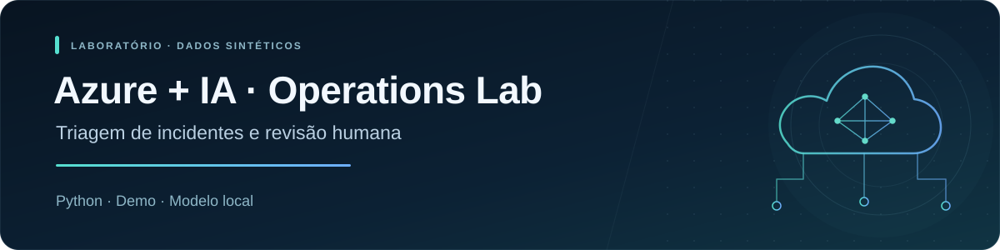

# Azure + IA: laboratório de operações

[](https://github.com/TiagoSilveiraSiqueira/azure-ai-operations-lab/actions/workflows/tests.yml)

Um laboratório de triagem de incidentes para quem está começando em IA aplicada a TI. Ele reúne exemplos sintéticos, seleções de postmortems públicos e um fluxo para entrada local. O programa referencia evidências e sugere próximos passos para revisão humana.

**Autor:** Tiago Silveira Siqueira · Supervisor de TI · IA aplicada e cloud

O projeto conecta raciocínio operacional, documentação e modelos locais. Não se conecta ao Azure, coleta dados do ambiente ou executa correções.

## Dois modos, com diferenças explícitas

| Modo | Como funciona | Precisa de modelo? |
|---|---|---|
| `demo` | Regras determinísticas classificam sintomas dos cenários embutidos ou de uma entrada local | Não; não usa LLM |
| `ollama` | Um modelo local propõe uma avaliação JSON; o programa valida esquema, categoria e IDs | Sim; Ollama e modelo já disponíveis na máquina |

Se o modo local falhar ou retornar uma estrutura inválida, o programa informa o fallback e usa as regras da demonstração. O campo `uses_llm` indica se a avaliação final veio do modelo.

## Comece em 10 minutos

Você precisa de **Python 3.10 ou superior**. O modo demo usa apenas a biblioteca padrão: não há dependências para instalar, chave de API ou conta cloud.

Baixe os arquivos ou clone este repositório, abra um terminal na pasta e execute:

**Windows:**

```powershell
python agent.py
python agent.py --list
python agent.py --incident INC-002
python -m unittest -v
```

Se sua instalação usa o lançador `py`, substitua `python` por `py`.

**Linux/macOS:**

```bash
python3 agent.py
python3 agent.py --list
python3 agent.py --incident INC-003
python3 -m unittest -v
```

Leia a avaliação, confira os IDs contra `INCIDENTS` em [agent.py](agent.py) e observe as perguntas pendentes. Altere uma métrica fictícia para um valor dentro da meta e execute novamente: a categoria deve refletir os dados disponíveis.

## Reutilizar com uma entrada local

O arquivo [incidents.example.json](incidents.example.json) contém os mesmos três cenários fictícios do programa. Você pode usá-lo diretamente:

```text
python agent.py --input incidents.example.json --list
python agent.py --input incidents.example.json --incident INC-002
```

O arquivo [incidents.public.example.json](incidents.public.example.json) contém duas seleções de fatos confirmados em postmortems públicos da Cloudflare (02/07/2019) e do GitHub (21/10/2018). São resumos de análises posteriores, sem métricas inventadas e sem atribuição de experiência ao autor do laboratório. Leia as fontes, as referências por ID e o exercício em [casos públicos](docs/casos-publicos.md).

```text
python agent.py --mode demo --input incidents.public.example.json --incident INC-101
python agent.py --mode demo --input incidents.public.example.json --incident INC-102
```

Essas entradas usam somente observações. O modo demo retorna `indeterminado` porque suas regras dependem de métricas estruturadas; isso não invalida as causas explicadas pelos postmortems. O exercício ensina a reconhecer esse limite, sem preencher lacunas com números inventados.

Para experimentar alterações, crie a pasta `local/` e copie o exemplo para `local/incidents.json`. A pasta é ignorada pelo Git. Edite somente a cópia e execute:

```text
python agent.py --input local/incidents.json --incident INC-001
```

Se `--incident` for omitido, o programa usa o primeiro incidente do arquivo. `--input` substitui a coleção embutida; os dois conjuntos não são mesclados.

Use dados fictícios ou previamente autorizados e anonimizados. Remova credenciais, dados pessoais e detalhes internos antes de escolher `--mode ollama`: nesse modo, **o incidente selecionado é enviado ao modelo na sua máquina**. A validação verifica formato e limites; ela não é um mecanismo de anonimização. Uma entrada válida e sua avaliação podem aparecer na saída do terminal.

O programa lê somente o arquivo escolhido no argumento. Ele não coleta logs, procura configurações, segue instruções contidas no JSON ou abre arquivos referenciados nos dados. Uma entrada inválida encerra o comando com código 2 e uma mensagem geral, sem reproduzir seus valores ou apresentar traceback.

### Formato e limites da entrada

A raiz deve ter apenas `incidents`, uma lista de **1 a 20 incidentes**. O arquivo deve ser JSON UTF-8 de no máximo **64 KiB**. Campos extras, campos repetidos no JSON e números não finitos são rejeitados.

Cada incidente precisa exatamente destes campos:

| Campo | Formato |
|---|---|
| `id` | `INC-001`; três dígitos e único no arquivo |
| `service` | Texto não vazio, até 120 caracteres |
| `reported_symptom` | Texto não vazio, até 600 caracteres |
| `window` | Texto não vazio, até 160 caracteres |
| `evidence` | Lista de 1 a 10 evidências |

Cada evidência tem um `id` como `E-101`, único em toda a coleção, e uma das formas abaixo:

| Forma | Campos adicionais exatos | Intervalo aceito |
|---|---|---|
| Observação | `observation` | Texto não vazio, até 400 caracteres |
| Latência | `metric: latency_p95_ms`, `value`, `target_max` | Números de 0 a 3.600.000 ms |
| Memória | `metric: memory_percent`, `value`, `target_max` | Números de 0 a 100 |
| CPU | `metric: cpu_percent`, `value` | Número de 0 a 100 |
| Fila | `metric: queue_length`, `value` | Inteiro de 0 a 1.000.000.000 |
| Telemetria | `metric: telemetry_available`, `value` | Booleano `true` ou `false` |

Esses intervalos limitam o formato do exercício; não representam metas operacionais. Os limiares de latência e memória vêm de `target_max` da entrada. Uma categoria só é aceita se as evidências citadas a sustentarem. Novas métricas exigem uma alteração explícita no programa e testes correspondentes.

## Exemplo de resultado

Recorte da saída padrão para `INC-001`:

```json
{
  "incident_id": "INC-001",
  "mode_requested": "demo",
  "mode_used": "demo",
  "uses_llm": false,
  "fallback": null,
  "assessment": {
    "category": "latencia",
    "summary": "A latência p95 supera a meta fornecida; a causa permanece desconhecida.",
    "evidence_ids": ["E-101", "E-102", "E-103"]
  }
}
```

A saída completa inclui hipóteses, perguntas e próximos passos. O limite de 400 ms é uma meta inventada para o exercício, não uma recomendação universal.

## Como o fluxo funciona

```text
Cenário fictício embutido OU arquivo local explicitamente escolhido
        ↓
Regras demo OU modelo local
        ↓
Validação de esquema, categoria e IDs de evidência
        ↓
Próximos passos do catálogo do programa
        ↓
Resultado JSON para revisão humana
```

O modelo não possui ferramentas e não decide comandos. Os próximos passos vêm de um catálogo de verificações descritivas mantido no código. Nenhum texto retornado é executado.

As categorias representam sintomas sustentados pelos dados, e não causas raiz. Validar estrutura e referências também não prova que todas as frases do modelo sejam verdadeiras: revise as hipóteses e o resumo.

## Experimentar um modelo local, opcionalmente

Esta etapa pode exigir download e memória adicional. Primeiro experimente o modo demo. Se você já possui [Ollama](https://ollama.com/) instalado e em execução local, disponibilize um modelo adequado à sua máquina, por exemplo:

```text
ollama pull qwen2.5:3b
python agent.py --mode ollama --incident INC-001 --model qwen2.5:3b
```

Em Linux/macOS, use `python3` na segunda linha. O download do modelo é uma etapa feita por você; este programa não instala ferramentas nem baixa modelos automaticamente.

A única chamada do programa é para `http://127.0.0.1:11434/api/generate`, sem autenticação, com o incidente selecionado da coleção embutida ou do arquivo escolhido. Não há opção para serviço remoto. Proxies herdados e redirecionamentos são desativados para manter essa requisição no endereço local. Não exponha o serviço local na rede para usar este exercício.

Um modelo pequeno pode produzir respostas inválidas ou demorar além do limite de 15 segundos, principalmente no primeiro carregamento. Nesse caso, confira `mode_used` e `fallback`; uma saída demo não comprova execução do modelo.

## Relação com Azure: arquitetura conceitual

Em um estudo futuro, métricas do Azure Monitor e consultas do Log Analytics poderiam fornecer evidências previamente selecionadas a um fluxo de triagem. Este laboratório representa somente a etapa de análise com entradas de estudo. Os casos públicos da Cloudflare e do GitHub não são implantações deste projeto no Azure.

```text
Azure Monitor / Log Analytics (conceito)
        ↓ evidências selecionadas e autorizadas
Camada de normalização (a desenvolver)
        ↓
Avaliação + validação
        ↓
Revisão humana e registro de decisão
```

**Nenhum recurso Azure foi implantado por este projeto.** Não há integração cloud pronta, estimativa de economia ou benchmark de produtividade. Um piloto real exigiria desenho próprio de dados, acesso, custo e revisão de resultados.

## O que os testes verificam

[test_agent.py](test_agent.py) usa `unittest` e simula o modelo local. Os testes cobrem classificação dos cenários, esquema e limites de entrada, erros sem exposição de valores, fluxo `--input`, arquivos de casos públicos sem métricas inventadas, IDs inválidos, categorias sem suporte, formato da resposta, fallback, endereço loopback, bloqueio de proxies/redirecionamentos e limite de resposta.

Os testes não chamam Ollama ou Azure. O comportamento com um modelo realmente instalado precisa ser experimentado na sua máquina.

A [automação de testes](.github/workflows/tests.yml) está configurada para Python 3.10 e 3.13, com permissões de leitura. Ela verifica compilação, testes e execuções demo com os arquivos sintético e de casos públicos. Não usa LLM, credenciais ou serviços cloud.

## Contribua

Sugira um novo cenário sintético com sintoma, evidências identificadas e resultado esperado. Uma melhoria útil mostra qual decisão ficou mais clara e como foi verificada. Não envie arquivos, logs ou configurações de um ambiente real.

Para um estudo de caso público, identifique a fonte original, separe fatos de hipóteses e use somente evidências que você consiga confirmar. O formato atual permite usar observações sem converter relatos em métricas.

Veja os passos de validação em [CONTRIBUTING.md](CONTRIBUTING.md).

Conteúdo sob [licença MIT](LICENSE).
